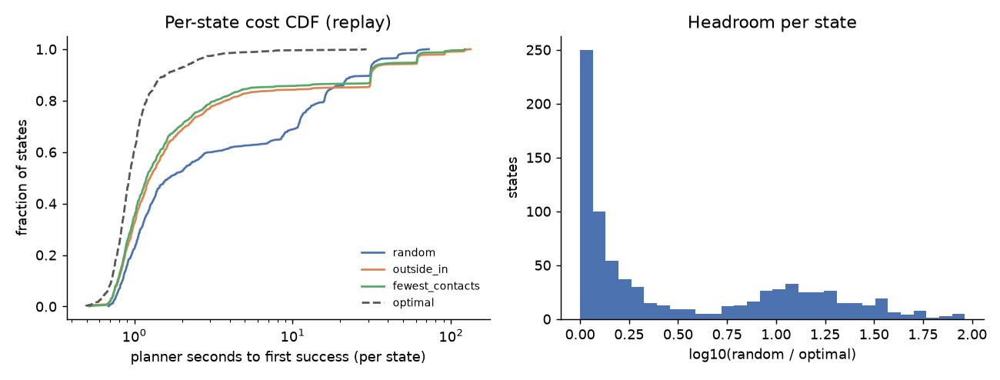

# Per-state replay on cached pilot queries (pilot_v0)

Source labels: `experiments/2026-11-22_replay_v0_final/labels_snapshot.jsonl` (2676 logged CMG-RRT queries). Cost = planner time only (time_s); SDF prep excluded. Bootstrap 95% CIs: 10,000 resamples, seed 0. This replays real logged queries; nothing is simulated. The trajectory through states is fixed by the labelling run, and each ordering only changes how much is spent finding the first success at each state.

- states with complete query sets: **866** (820 with >= 1 success, 46 with none) across **336** assemblies
- states with no success (every ordering pays everything): 46, total 5059 s, median 91 s/state

## Per-state cost to first success (s), states with >= 1 success

| ordering | median [95% CI] | mean [95% CI] |
|---|---|---|
| random | 1.66 [1.45, 2.06] | 8.65 [7.80, 9.53] |
| outside_in | 1.26 [1.19, 1.35] | 8.87 [7.53, 10.30] |
| fewest_contacts | 1.19 [1.15, 1.27] | 7.85 [6.64, 9.13] |
| optimal (unattainable lower bound) | 0.93 [0.91, 0.95] | 1.21 [1.11, 1.34] |

## Per-assembly cost (s): sum over the visited states with >= 1 success

| ordering | median [95% CI] | mean [95% CI] |
|---|---|---|
| random | 12.40 [11.19, 15.45] | 23.33 [20.46, 26.21] |
| outside_in | 4.90 [4.25, 5.74] | 23.93 [19.91, 28.10] |
| fewest_contacts | 4.66 [4.07, 5.40] | 21.16 [17.70, 24.83] |
| optimal | 2.74 [2.53, 2.93] | 3.27 [2.97, 3.63] |

## Headroom (cost of ordering divided by hindsight-optimal)

Ratio of totals over states, with a bootstrap CI over states. Also the median of per-state ratios.

| ordering | ratio of totals [95% CI] | median per-state ratio |
|---|---|---|
| random / optimal | 7.13 [6.36, 7.96] | 1.61 |
| outside_in / optimal | 7.31 [6.15, 8.62] | 1.17 |
| fewest_contacts / optimal | 6.47 [5.42, 7.62] | 1.12 |

## Rotation split (assembly has a successful logged path with max rotation > 15 deg)

Caveat: an RRT path can rotate even when a pure translation would work, so this measures rotation *in the logged path*, not rotation that was *needed*.

| group | assemblies | states | random/optimal (ratio of totals) [95% CI] |
|---|---|---|---|
| rotation > thr | 9 | 28 | 4.84 [3.30, 7.88] |
| translation-like | 295 | 792 | 7.32 [6.51, 8.17] |

