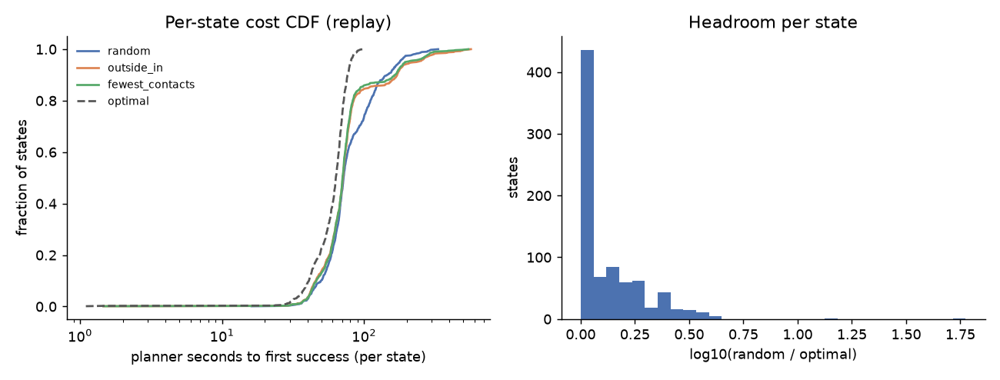

# Per-state replay on cached pilot queries (pilot_v0)

Source labels: `experiments/2026-11-22_replay_v0_final/labels_snapshot.jsonl` (2676 logged CMG-RRT queries). Cost = planner time + SDF prep. Bootstrap 95% CIs: 10,000 resamples, seed 0. This replays real logged queries; nothing is simulated. The trajectory through states is fixed by the labelling run, and each ordering only changes how much is spent finding the first success at each state.

- states with complete query sets: **866** (820 with >= 1 success, 46 with none) across **336** assemblies
- states with no success (every ordering pays everything): 46, total 15465 s, median 318 s/state

## Per-state cost to first success (s), states with >= 1 success

| ordering | median [95% CI] | mean [95% CI] |
|---|---|---|
| random | 71.82 [70.83, 73.15] | 87.23 [84.28, 90.31] |
| outside_in | 70.96 [70.00, 71.97] | 89.75 [85.10, 94.68] |
| fewest_contacts | 70.59 [69.82, 71.68] | 86.41 [82.35, 90.74] |
| optimal (unattainable lower bound) | 63.30 [62.57, 64.40] | 60.99 [60.03, 61.93] |

## Per-assembly cost (s): sum over the visited states with >= 1 success

| ordering | median [95% CI] | mean [95% CI] |
|---|---|---|
| random | 215.90 [203.39, 225.79] | 235.29 [222.16, 248.68] |
| outside_in | 209.89 [192.66, 229.65] | 242.08 [226.13, 258.86] |
| fewest_contacts | 206.13 [192.66, 224.48] | 233.08 [219.00, 248.01] |
| optimal | 144.56 [137.62, 158.90] | 164.51 [157.30, 171.91] |

## Headroom (cost of ordering divided by hindsight-optimal)

Ratio of totals over states, with a bootstrap CI over states. Also the median of per-state ratios.

| ordering | ratio of totals [95% CI] | median per-state ratio |
|---|---|---|
| random / optimal | 1.43 [1.39, 1.47] | 1.13 |
| outside_in / optimal | 1.47 [1.40, 1.55] | 1.07 |
| fewest_contacts / optimal | 1.42 [1.35, 1.49] | 1.06 |

## Rotation split (assembly has a successful logged path with max rotation > 15 deg)

Caveat: an RRT path can rotate even when a pure translation would work, so this measures rotation *in the logged path*, not rotation that was *needed*.

| group | assemblies | states | random/optimal (ratio of totals) [95% CI] |
|---|---|---|---|
| rotation > thr | 9 | 28 | 1.50 [1.28, 1.76] |
| translation-like | 295 | 792 | 1.43 [1.39, 1.47] |

