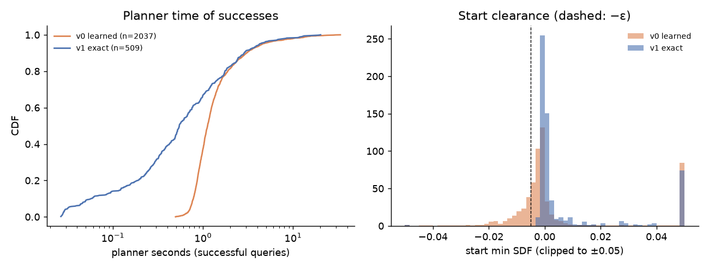

# R5 analysis: pilot_v0 (learned SDF) vs pilot_v1 (exact union SDF, eps 0.005)

Sources: `data/labels/pilot_v0/`, `data/labels/pilot_v1/` (logged CMG-RRT queries, T = 30 s). Generated by `scripts/analysis_v1.py`. Nothing here is simulated.

## Label counts

- v1: **565 queries**, 184 states, 68 assemblies with labels; summaries: {'complete': 63, 'stuck': 2}
- v1 skip reasons: {}
- v0 (run 01): 2676 queries, summaries: {'skipped': 408, 'stuck': 45, 'complete': 284}

## All labels: v0 vs v1

| metric | v0 learned | v1 exact |
|---|---|---|
| queries | 2676 | 565 |
| success_rate | 0.761 | 0.901 |
| unsolved | 639 | 56 |
| unsolved_start_invalid | 546 | 1 |
| start_invalid_share_of_unsolved | 0.854 | 0.018 |
| start_valid_rate_all | 0.767 | 0.998 |
| errors | 0 | 0 |
| success_time_p10_p50_p90 | [0.781, 1.123, 3.041] | [0.059, 0.545, 2.861] |
| success_iter_p50_p90_max | [1, 1, 255] | [1, 1, 70] |
| planner_s_total | 22960.677 | 2368.492 |
| prep_s_p50_p90 | [66.096, 79.504] | [0.023, 0.069] |
| setup_time_s_p50_p90 | None | [0.024, 0.052] |

## Paired comparison on the assembled state (depth 0), 68 assemblies labelled in both, 261 (assembly, part) queries

| metric | v0 learned | v1 exact |
|---|---|---|
| success_rate | 0.678 | 0.877 |
| unsolved | 84 | 32 |
| unsolved_start_invalid | 69 | 0 |
| start_invalid_share_of_unsolved | 0.821 | 0.000 |
| start_valid_rate_all | 0.697 | 1.000 |
| success_time_p10_p50_p90 | [0.873, 1.279, 3.45] | [0.256, 0.888, 3.579] |
| planner_s_total | 2899.971 | 1355.730 |

Outcome crosstab (v0 → v1): success→success: 174, success→unsolved: 3, unsolved→success: 55, unsolved→unsolved: 29

Of the 84 v0-unsolved queries, 55 succeed in v1; 52 of those had an invalid v0 start (SDF artifact).

Queries that succeed in both (174): planner time v1/v0 per query median 0.45 (p10 0.18, p90 1.22); v0 median 1.28 s, v1 median 0.67 s.

## Assembly status, v0 → v1 (65 assemblies with a summary in both)

complete→complete: 54, stuck→complete: 9, stuck→stuck: 2

Stuck in v0 and complete in v1: **9** (00014, 00221, 00271, 00302, 00413, 00419, 00614, 00673, 00784)

Complete in v0 and stuck in v1: **0** ()

## Rotation in v1 successful paths (max rotation > 15°)

1 of 509 successful queries, 1 states, 1 assemblies. Caveat: CMG-RRT paths can rotate when a translation would also work, so this is rotation *in the logged path*, not rotation that was *needed*.

Successful v1 queries needing more than 1 RRT iteration: 29 (20 assemblies).

## Labelling throughput

Last progress line of `experiments/2026-11-22_pilot_v1_labels/stdout.log`: 570 queries in 5.9 min = **5797 queries/hour** (10 workers, this session; includes restarts' first state only from the restart time).

## Per-state replay on v1

- `reports/run02/replay_pilot_v1.md` (exit 0)
- `reports/run02/replay_pilot_v1_with_prep.md` (exit 0)

Key replay tables are reproduced in REPORT.md; the full tables are in the two files above.
