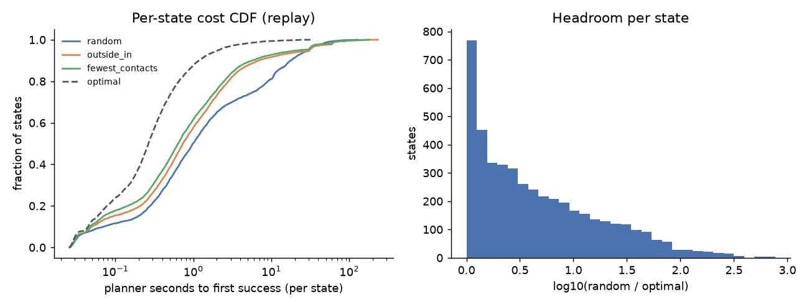

# Per-state replay on cached pilot queries (pilot_v1 (planner only))

Source labels: `data/labels/pilot_v1/labels.jsonl` (17116 logged CMG-RRT queries). Cost = planner time only (time_s); SDF prep excluded. Bootstrap 95% CIs: 10,000 resamples, seed 0. This replays real logged queries; nothing is simulated. The trajectory through states is fixed by the labelling run, and each ordering only changes how much is spent finding the first success at each state.

- states with complete query sets: **4685** (4606 with >= 1 success, 79 with none) across **1328** assemblies
- states with no success (every ordering pays everything): 79, total 7737 s, median 91 s/state

## Per-state cost to first success (s), states with >= 1 success

| ordering | median [95% CI] | mean [95% CI] |
|---|---|---|
| random | 0.98 [0.94, 1.06] | 5.88 [5.54, 6.23] |
| outside_in | 0.73 [0.70, 0.77] | 4.62 [4.20, 5.04] |
| fewest_contacts | 0.64 [0.61, 0.67] | 4.01 [3.64, 4.41] |
| optimal (unattainable lower bound) | 0.27 [0.26, 0.27] | 0.63 [0.58, 0.68] |

## Per-assembly cost (s): sum over the visited states with >= 1 success

| ordering | median [95% CI] | mean [95% CI] |
|---|---|---|
| random | 5.19 [4.47, 6.25] | 20.79 [18.76, 22.90] |
| outside_in | 3.21 [2.91, 3.53] | 16.33 [14.30, 18.48] |
| fewest_contacts | 2.90 [2.70, 3.16] | 14.18 [12.48, 16.04] |
| optimal | 1.01 [0.97, 1.09] | 2.23 [1.97, 2.52] |

## Headroom (cost of ordering divided by hindsight-optimal)

Ratio of totals over states, with a bootstrap CI over states. Also the median of per-state ratios.

| ordering | ratio of totals [95% CI] | median per-state ratio [95% CI] |
|---|---|---|
| random / optimal | 9.33 [8.77, 9.96] | 3.31 [3.13, 3.43] |
| outside_in / optimal | 7.33 [6.68, 8.06] | 1.92 [1.80, 2.02] |
| fewest_contacts / optimal | 6.37 [5.78, 7.01] | 1.57 [1.50, 1.64] |

## Rotation split (assembly has a successful logged path with max rotation > 15 deg)

Caveat: an RRT path can rotate even when a pure translation would work, so this measures rotation *in the logged path*, not rotation that was *needed*.

| group | assemblies | states | random/optimal (ratio of totals) [95% CI] |
|---|---|---|---|
| rotation > thr | 57 | 249 | 6.48 [5.36, 8.28] |
| translation-like | 1245 | 4357 | 9.90 [9.33, 10.52] |

**State-level rotation subset** (a successful query at the state has max path rotation > 15 deg): 70 states in 57 assemblies.

| ordering / optimal (rotation states) | ratio of totals [95% CI] | median per-state ratio |
|---|---|---|
| random | 5.43 [4.18, 7.76] | 10.82 |
| outside_in | 5.40 [3.29, 9.33] | 2.86 |
| fewest_contacts | 3.96 [2.47, 6.71] | 1.71 |

