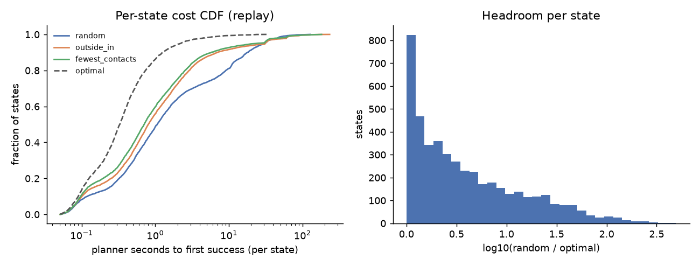

# Per-state replay on cached pilot queries (pilot_v1 (planner + prep + setup))

Source labels: `data/labels/pilot_v1/labels.jsonl` (17116 logged CMG-RRT queries). Cost = planner time + SDF prep. Bootstrap 95% CIs: 10,000 resamples, seed 0. This replays real logged queries; nothing is simulated. The trajectory through states is fixed by the labelling run, and each ordering only changes how much is spent finding the first success at each state.

- states with complete query sets: **4685** (4606 with >= 1 success, 79 with none) across **1328** assemblies
- states with no success (every ordering pays everything): 79, total 7759 s, median 91 s/state

## Per-state cost to first success (s), states with >= 1 success

| ordering | median [95% CI] | mean [95% CI] |
|---|---|---|
| random | 1.06 [1.00, 1.12] | 5.95 [5.62, 6.30] |
| outside_in | 0.80 [0.77, 0.84] | 4.69 [4.27, 5.12] |
| fewest_contacts | 0.71 [0.67, 0.74] | 4.08 [3.71, 4.49] |
| optimal (unattainable lower bound) | 0.33 [0.32, 0.34] | 0.69 [0.65, 0.74] |

## Per-assembly cost (s): sum over the visited states with >= 1 success

| ordering | median [95% CI] | mean [95% CI] |
|---|---|---|
| random | 5.44 [4.67, 6.57] | 21.06 [19.02, 23.18] |
| outside_in | 3.46 [3.10, 3.77] | 16.59 [14.55, 18.74] |
| fewest_contacts | 3.10 [2.90, 3.36] | 14.43 [12.73, 16.30] |
| optimal | 1.24 [1.17, 1.34] | 2.45 [2.19, 2.75] |

## Headroom (cost of ordering divided by hindsight-optimal)

Ratio of totals over states, with a bootstrap CI over states. Also the median of per-state ratios.

| ordering | ratio of totals [95% CI] | median per-state ratio [95% CI] |
|---|---|---|
| random / optimal | 8.59 [8.11, 9.12] | 2.83 [2.69, 2.95] |
| outside_in / optimal | 6.76 [6.18, 7.40] | 1.75 [1.67, 1.84] |
| fewest_contacts / optimal | 5.89 [5.36, 6.46] | 1.48 [1.42, 1.53] |

## Rotation split (assembly has a successful logged path with max rotation > 15 deg)

Caveat: an RRT path can rotate even when a pure translation would work, so this measures rotation *in the logged path*, not rotation that was *needed*.

| group | assemblies | states | random/optimal (ratio of totals) [95% CI] |
|---|---|---|---|
| rotation > thr | 57 | 249 | 6.33 [5.26, 7.99] |
| translation-like | 1245 | 4357 | 9.01 [8.51, 9.53] |

**State-level rotation subset** (a successful query at the state has max path rotation > 15 deg): 70 states in 57 assemblies.

| ordering / optimal (rotation states) | ratio of totals [95% CI] | median per-state ratio |
|---|---|---|
| random | 5.34 [4.14, 7.54] | 10.17 |
| outside_in | 5.31 [3.26, 9.08] | 2.33 |
| fewest_contacts | 3.90 [2.44, 6.54] | 1.69 |

