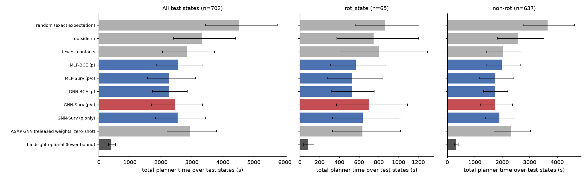
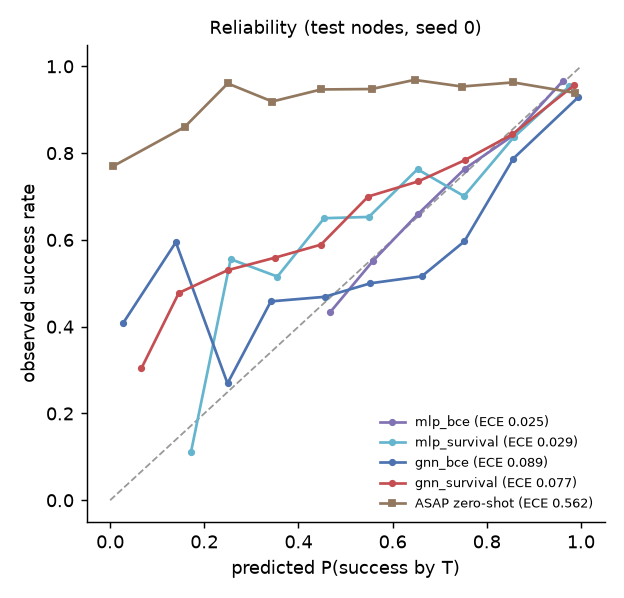

# Run 03 R5: test-split replay results (evaluated once)

Script `scripts/eval_replay_test.py`; outputs `experiments/2026-11-23_run03_eval_test/` (per-state costs in `per_state.jsonl`, all numbers in `results.json`). Checkpoints: `experiments/2026-11-23_run03_train_v2/<variant>/seed<k>/best.pt`, seeds 100-104, protocol v2 (selected on val). ASAP scores: `experiments/2026-11-23_run03_asap/scores.jsonl`. Cost = logged CMG-RRT planner time (time_s) of the queries an ordering makes at a state, up to and including the first success. This replays real logged queries; nothing is simulated.

- test split: 716 states over 204 assemblies; **702** states with >= 1 success are scored; 14 states have no success. Every ordering pays all of their queries there: 1515 s in total.
- trained models: 5 seeds each (configs chosen on val, `experiments/2026-11-23_run03_train_v2/<variant>/selection.json`). The total is shown with its CI over the seed-averaged per-state cost; 'seeds:' gives mean ± std of the 5 per-seed totals.
- CIs: bootstrap over assemblies (10,000 resamples). Ratios use hindsight-optimal = cheapest successful query at the state.

## Main table (all test states with >= 1 success)

### All states: 702 states, 197 assemblies

| ordering | total planner time (s) [95% CI] | mean per state (s) [95% CI] | median per-state ratio to optimal [95% CI] | mean queries to first success |
|---|---|---|---|---|
| random (exact expectation) | 4519 [3438, 5758] | 6.44 [4.98, 8.04] | 3.83 [3.25, 4.78] | 1.15 |
| outside-in | 3322 [2405, 4417] | 4.73 [3.48, 6.20] | 2.01 [1.65, 2.40] | 1.08 |
| fewest contacts | 2832 [2051, 3739] | 4.03 [2.96, 5.18] | 1.67 [1.42, 2.05] | 1.06 |
| MLP-BCE (p) | 2555 [1847, 3353] (seeds: 2555 ± 199) | 3.64 [2.65, 4.77] | 1.62 [1.44, 2.06] | 1.06 |
| MLP-Surv (p/c) | 2271 [1565, 3114] (seeds: 2271 ± 93) | 3.23 [2.26, 4.41] | 1.34 [1.22, 1.49] | 1.06 |
| GNN-BCE (p) | 2266 [1734, 2849] (seeds: 2266 ± 225) | 3.23 [2.52, 3.98] | 1.90 [1.60, 2.17] | 1.05 |
| GNN-Surv (p/c) | 2450 [1700, 3347] (seeds: 2450 ± 89) | 3.49 [2.45, 4.69] | 1.16 [1.09, 1.24] | 1.08 |
| GNN-Surv (p only) | 2538 [1817, 3434] (seeds: 2538 ± 218) | 3.61 [2.62, 4.74] | 1.64 [1.44, 1.89] | 1.07 |
| ASAP GNN (released weights, zero-shot) | 2950 [2200, 3794] | 4.20 [3.18, 5.35] | 2.44 [2.03, 2.82] | 1.06 |
| hindsight-optimal (lower bound) | 405 [305, 540] | 0.58 [0.44, 0.76] | 1.00 [1.00, 1.00] | 1.00 |

Paired: GNN-Surv (p/c) minus each ordering, per-assembly summed cost (negative = GNN-Surv (p/c) cheaper). n = 197 assemblies.

| comparison | mean diff per assembly (s) [95% paired bootstrap CI] | ratio of totals [95% CI] | Wilcoxon p | Holm-adjusted p |
|---|---|---|---|---|
| vs random (exact expectation) | -10.50 [-14.75, -6.69] | 0.542 [0.422, 0.677] | 3e-16 | 2.4e-15 |
| vs outside-in | -4.43 [-8.37, -0.76] | 0.737 [0.566, 0.950] | 8.5e-06 | 3.4e-05 |
| vs fewest contacts | -1.94 [-4.90, +0.99] | 0.865 [0.685, 1.075] | 3.3e-05 | 6.7e-05 |
| vs MLP-BCE (p) | -0.53 [-2.61, +1.60] | 0.959 [0.803, 1.127] | 2e-05 | 6.1e-05 |
| vs MLP-Surv (p/c) | +0.91 [-1.04, +3.10] | 1.079 [0.915, 1.292] | 0.035 | 0.035 |
| vs GNN-BCE (p) | +0.93 [-1.40, +3.71] | 1.081 [0.874, 1.309] | 7.4e-07 | 3.7e-06 |
| vs GNN-Surv (p only) | -0.45 [-1.80, +0.90] | 0.965 [0.856, 1.072] | 6.1e-08 | 3.7e-07 |
| vs ASAP GNN (released weights, zero-shot) | -2.54 [-5.57, +0.43] | 0.830 [0.648, 1.032] | 3.4e-08 | 2.4e-07 |

## Rotation subsets (rot_state from R1; evaluation-only flag)

### rot_state states: 65 states, 33 assemblies

| ordering | total planner time (s) [95% CI] | mean per state (s) [95% CI] | median per-state ratio to optimal [95% CI] | mean queries to first success |
|---|---|---|---|---|
| random (exact expectation) | 868 [560, 1209] | 13.35 [9.70, 17.56] | 13.45 [8.70, 23.02] | 1.27 |
| outside-in | 748 [375, 1206] | 11.51 [5.93, 18.86] | 3.98 [2.66, 10.06] | 1.17 |
| fewest contacts | 803 [398, 1292] | 12.35 [6.22, 20.43] | 4.01 [2.23, 11.20] | 1.20 |
| MLP-BCE (p) | 568 [312, 873] (seeds: 568 ± 56) | 8.73 [4.85, 13.91] | 3.76 [1.80, 5.30] | 1.14 |
| MLP-Surv (p/c) | 532 [276, 840] (seeds: 532 ± 49) | 8.19 [4.22, 13.27] | 3.36 [1.53, 5.57] | 1.15 |
| GNN-BCE (p) | 527 [323, 754] (seeds: 527 ± 108) | 8.11 [5.14, 11.77] | 5.08 [2.68, 7.06] | 1.13 |
| GNN-Surv (p/c) | 704 [371, 1093] (seeds: 704 ± 96) | 10.83 [6.05, 17.00] | 3.94 [2.08, 6.59] | 1.24 |
| GNN-Surv (p only) | 636 [332, 1015] (seeds: 636 ± 134) | 9.79 [5.13, 15.96] | 3.91 [1.71, 7.88] | 1.19 |
| ASAP GNN (released weights, zero-shot) | 635 [330, 1022] | 9.76 [5.21, 16.33] | 3.35 [1.60, 11.20] | 1.14 |
| hindsight-optimal (lower bound) | 84 [40, 144] | 1.29 [0.66, 2.21] | 1.00 [1.00, 1.00] | 1.00 |

Paired: GNN-Surv (p/c) minus each ordering, per-assembly summed cost (negative = GNN-Surv (p/c) cheaper). n = 33 assemblies.

| comparison | mean diff per assembly (s) [95% paired bootstrap CI] | ratio of totals [95% CI] | Wilcoxon p | Holm-adjusted p |
|---|---|---|---|---|
| vs random (exact expectation) | -4.95 [-13.78, +3.07] | 0.812 [0.512, 1.124] | 0.14 | 1 |
| vs outside-in | -1.32 [-11.55, +7.60] | 0.942 [0.596, 1.492] | 0.99 | 1 |
| vs fewest contacts | -2.99 [-14.71, +6.41] | 0.877 [0.540, 1.389] | 0.74 | 1 |
| vs MLP-BCE (p) | +4.14 [-0.34, +9.27] | 1.241 [0.977, 1.590] | 0.77 | 1 |
| vs MLP-Surv (p/c) | +5.22 [+0.77, +11.05] | 1.323 [1.051, 1.822] | 0.17 | 1 |
| vs GNN-BCE (p) | +5.36 [-0.53, +12.00] | 1.336 [0.961, 1.707] | 0.93 | 1 |
| vs GNN-Surv (p only) | +2.06 [-1.26, +6.47] | 1.107 [0.931, 1.419] | 0.7 | 1 |
| vs ASAP GNN (released weights, zero-shot) | +2.11 [-6.01, +10.15] | 1.110 [0.727, 1.720] | 0.88 | 1 |

### non-rot states: 637 states, 193 assemblies

| ordering | total planner time (s) [95% CI] | mean per state (s) [95% CI] | median per-state ratio to optimal [95% CI] | mean queries to first success |
|---|---|---|---|---|
| random (exact expectation) | 3651 [2767, 4644] | 5.73 [4.43, 7.15] | 3.33 [2.95, 4.12] | 1.13 |
| outside-in | 2575 [1818, 3519] | 4.04 [2.88, 5.45] | 1.90 [1.52, 2.28] | 1.07 |
| fewest contacts | 2029 [1443, 2686] | 3.19 [2.31, 4.17] | 1.59 [1.34, 1.94] | 1.05 |
| MLP-BCE (p) | 1987 [1413, 2673] (seeds: 1987 ± 187) | 3.12 [2.23, 4.18] | 1.55 [1.39, 1.88] | 1.06 |
| MLP-Surv (p/c) | 1739 [1162, 2429] (seeds: 1739 ± 66) | 2.73 [1.81, 3.83] | 1.30 [1.20, 1.41] | 1.06 |
| GNN-BCE (p) | 1739 [1314, 2210] (seeds: 1739 ± 171) | 2.73 [2.08, 3.43] | 1.77 [1.52, 2.03] | 1.04 |
| GNN-Surv (p/c) | 1746 [1222, 2367] (seeds: 1746 ± 112) | 2.74 [1.92, 3.68] | 1.12 [1.06, 1.18] | 1.06 |
| GNN-Surv (p only) | 1901 [1384, 2474] (seeds: 1901 ± 110) | 2.99 [2.18, 3.88] | 1.55 [1.36, 1.75] | 1.06 |
| ASAP GNN (released weights, zero-shot) | 2315 [1703, 3028] | 3.63 [2.75, 4.68] | 2.39 [1.99, 2.76] | 1.06 |
| hindsight-optimal (lower bound) | 321 [256, 400] | 0.50 [0.41, 0.62] | 1.00 [1.00, 1.00] | 1.00 |

Paired: GNN-Surv (p/c) minus each ordering, per-assembly summed cost (negative = GNN-Surv (p/c) cheaper). n = 193 assemblies.

| comparison | mean diff per assembly (s) [95% paired bootstrap CI] | ratio of totals [95% CI] | Wilcoxon p | Holm-adjusted p |
|---|---|---|---|---|
| vs random (exact expectation) | -9.87 [-13.47, -6.67] | 0.478 [0.376, 0.591] | 2.9e-18 | 2.3e-17 |
| vs outside-in | -4.30 [-7.88, -1.01] | 0.678 [0.512, 0.907] | 6.9e-08 | 3.4e-07 |
| vs fewest contacts | -1.47 [-4.03, +1.07] | 0.860 [0.659, 1.120] | 2.8e-06 | 8.3e-06 |
| vs MLP-BCE (p) | -1.25 [-3.14, +0.45] | 0.878 [0.728, 1.051] | 2.8e-06 | 8.3e-06 |
| vs MLP-Surv (p/c) | +0.04 [-1.53, +1.54] | 1.004 [0.856, 1.206] | 0.01 | 0.01 |
| vs GNN-BCE (p) | +0.04 [-1.87, +2.19] | 1.004 [0.797, 1.251] | 9.3e-08 | 3.7e-07 |
| vs GNN-Surv (p only) | -0.81 [-2.05, +0.32] | 0.918 [0.793, 1.034] | 6.7e-09 | 4e-08 |
| vs ASAP GNN (released weights, zero-shot) | -2.95 [-5.70, -0.22] | 0.754 [0.574, 0.979] | 8e-11 | 5.6e-10 |

## Calibration and prediction quality (test nodes, all test states)

ECE: 10 equal-width bins of p against the observed success. C-index (Harrell, censored): a pair is comparable when part i succeeded at t_i < t_j. The predicted 'speed' is p for BCE heads and −c (expected cost) for survival heads. 'within-state' uses only pairs at the same state, which is what an ordering needs. Values are mean ± std over the 5 seeds.

| model | head | ECE of p | C-index (pooled) | C-index (within-state) |
|---|---|---|---|---|
| MLP | bce | 0.025 ± 0.017 | 0.692 ± 0.011 | 0.576 ± 0.008 |
| MLP | survival | 0.029 ± 0.015 | 0.761 ± 0.015 | 0.628 ± 0.018 |
| GNN | bce | 0.089 ± 0.022 | 0.660 ± 0.019 | 0.581 ± 0.016 |
| GNN | survival | 0.077 ± 0.018 | 0.785 ± 0.007 | 0.665 ± 0.008 |
| ASAP (zero-shot; its score is P(part is the next removed), not P(planner success)) | BCE | 0.562 | 0.540 | 0.486 |

